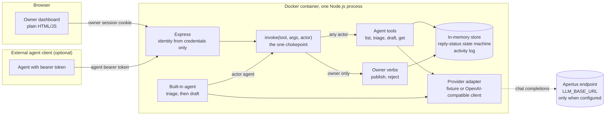
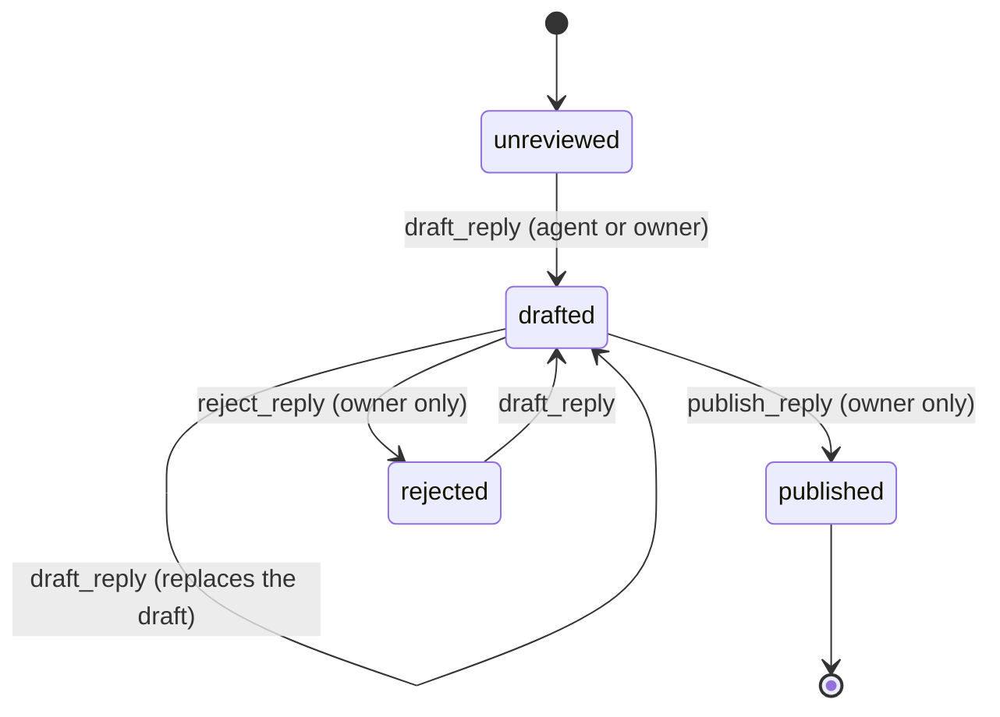

# Architecture

One Node.js process, one container, one optional outbound connection (to the model
endpoint you configure). Licence: CC-BY-4.0. The same picture as a standalone figure, used in
the technical report: [`architecture.svg`](architecture.svg).

## Components and data flow

The dashboard, the HTTP API and the built-in agent all call `invoke()`. There is no other
way to change a review, so a rule enforced there is enforced for everyone.

## The approval gate

`publish_reply` and `reject_reply` change what the public sees. They sit in
`src/owner-verbs.js`, apart from the agent registry in `src/tools.js`.

| Layer | Where | What it does |
|---|---|---|
| Registry | `src/invoke.js` | Looks a tool up in the agent registry first; owner verbs only for the owner |
| Handler | `src/owner-verbs.js` | Each owner verb checks the actor again |
| State machine | `src/store.js` | `published` is reachable only through `publish()`, which needs a waiting draft |

A request that claims an actor its credential does not prove is refused at the HTTP edge
(`forged_actor`) and logged.

## Reply status

`triage_reviews` records the language and category and leaves the status as `unreviewed`.

## The provider adapter

`classify(review)` and `draftReply(review)`, in two implementations chosen at start-up:

- `FakeApertusProvider`: canned, deterministic output; no network. Used when no `LLM_*` variable
  is set and by every test.
- `OpenAICompatibleProvider`: a chat-completions client for `LLM_BASE_URL`, with `LLM_NAME` and
  `LLM_API_KEY`. It asks for a JSON object, validates it, and retries once with the problem
  spelled out; it applies a timeout; the key is never logged. The reply-language check is not in
  the client: `draft_reply` applies the server's own detector to every provider's reply.

Setting some but not all of the three variables, or a base URL that is not plain http(s) without
credentials, stops the start-up; there is no fallback from a configured endpoint to the fixture.

## Evaluation

`scripts/eval.js` runs the built-in agent, through `invoke()`, over `data/eval-set.json` with any
provider, wraps the provider to time each call, and writes `data/eval-results.json`, including the
provider's kind, model name, endpoint host and the date.

## What contacts what

| When | Contacts | Carries |
|---|---|---|
| Build time | Docker registry (base image `node:24.21.0-bookworm-slim`, pinned by digest), npm registry (`npm ci --omit=dev --ignore-scripts`) | Package downloads only |
| Runtime, `LLM_*` unset | Nothing | Nothing leaves the container |
| Runtime, `LLM_*` set | The one host in `LLM_BASE_URL` | The review text and the instructions for classifying and replying |

The runtime has no analytics, no fonts or scripts from a CDN, and no telemetry. The
dashboard loads only its own files, enforced by a content security policy.

## The container

`make run` builds the image from `Dockerfile` and starts it with `docker run`. The image is
`node:24.21.0-bookworm-slim` (pinned by digest) plus `src/` and the two data files the server
reads; it runs as the `node` user and has a health check on `/`. The container is started with a
read-only filesystem, every capability dropped, `no-new-privileges`, an init process and the port
published on the host's loopback only. `LLM_NAME`, `LLM_BASE_URL` and `LLM_API_KEY` are passed by
name from the environment of `make run`, or read from the file `ENV_FILE` names, so no key is in
the image, the Makefile or a command line. `scripts/preflight.sh` runs on the host around the
build: it stops a half-set `LLM_*` configuration before the build, and prints a banner when the
fixture is about to answer instead of a model.
